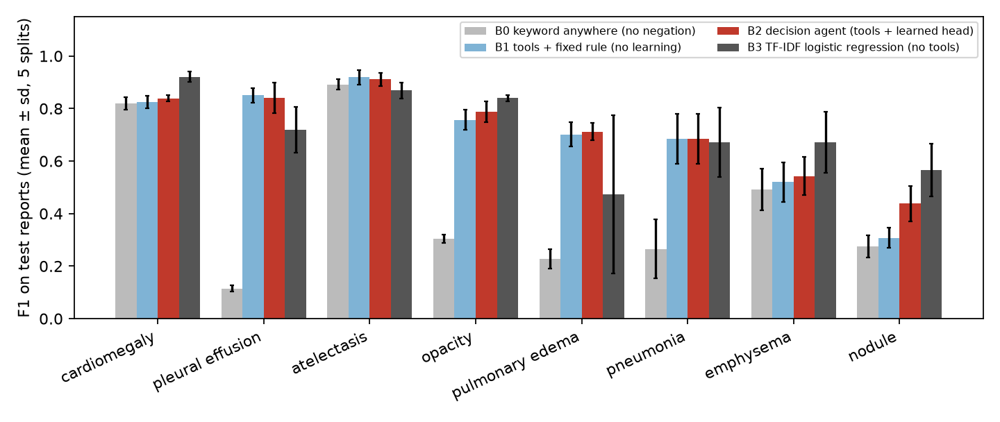
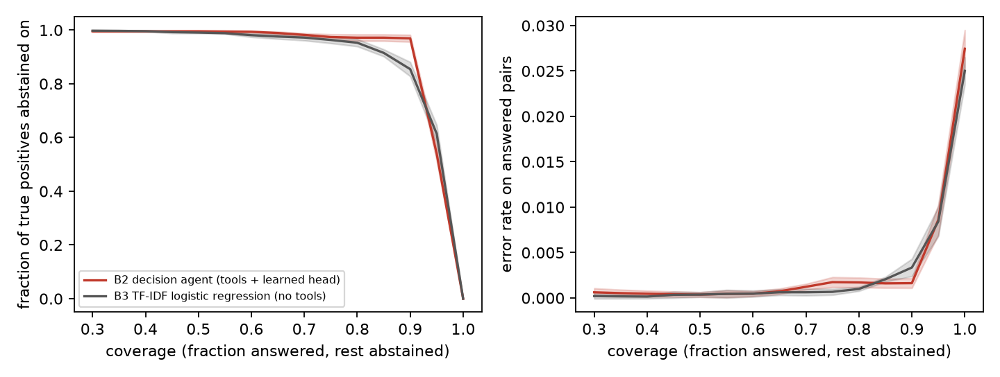
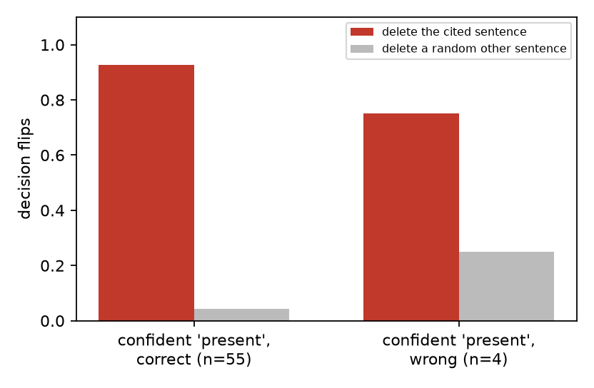

# Auditable decision agent for chest X-ray report findings

> A small tool-using agent decides, for each of 8 findings, whether a chest X-ray report says the finding is present.
> It calls tools (impression lookup, findings lookup only when needed, NegEx-style negation/uncertainty assessment),
> turns their output into a probability with one shared logistic head, and either answers or abstains. It never writes
> free text, and every answer cites one sentence. On 3,927 public Indiana University reports it reaches a macro F1 on
> par with a TF-IDF logistic regression (no significant difference, paired bootstrap), and the cited sentence is
> necessary for the answer: deleting it flips 93 % of confident correct "present" answers, deleting a random other
> sentence flips 4 %. The confidence threshold is a poor abstention tool for rare findings (details below).

**Context.** Bao et al., *Auditable Clinical Support with Decision Agents*, arXiv:2611.23700 (2026) [1], with Daniel
Truhn among the authors, describe Decision2Care, a "decision agent" that works up a patient without producing text: a
decision model assigns a probability to each permitted EHR action and fixed rules carry out the most probable one. Per
its abstract, errors where it was confident but wrong were traced to single imaging reports, and removing that report
corrected three of four. I read the abstract (arXiv API) and the OpenAlex record, not the full text. This repository is
**not** a reproduction of that system and uses none of its data. It is a small, public-data exercise in the same shape:
probabilities over tool outcomes, fixed execution rules, abstention, and a trace that points to one piece of evidence.
Independent student project, not affiliated with the authors.

## Question
On radiology report text, can an agent that is forced to act through a few tools and a fixed rule set match a plain
text classifier, and are its answers auditable in a testable sense: is the sentence it cites really the reason for the
answer, and what does it get wrong when it is confident?

## Data
Open-i / Indiana University Chest X-ray Collection reports ([Demner-Fushman et al.](https://doi.org/10.1093/jamia/ocv080)
[2]), `NLMCXR_reports.tgz` (1.1 MB, no login, CC BY-NC-ND 4.0; `make data`; never committed). Each report has
FINDINGS / IMPRESSION text (identifiers anonymised, shown as `XXXX`) and **manually assigned MeSH major tags**. The label
"finding present" = the finding's MeSH tag is among the report's major tags. Reports without FINDINGS and IMPRESSION are
dropped. There is no patient identifier in the public files, so splits are by report (hashed id), which can leak
near-duplicate templates between train and test.

<!-- table:data -->
| finding | reports with MeSH tag | share |
|---|---|---|
| cardiomegaly | 375 | 9.5 % |
| pleural effusion | 161 | 4.1 % |
| atelectasis | 332 | 8.5 % |
| opacity | 455 | 11.6 % |
| pulmonary edema | 46 | 1.2 % |
| pneumonia | 42 | 1.1 % |
| emphysema | 98 | 2.5 % |
| nodule | 111 | 2.8 % |
| **all reports used** | 3927 | |
<!-- /table:data -->

## Method
- **Tools** (`src/cxr_report_decision_agent/tools.py`, from scratch, no NLP library): sentence splitting; `find_mentions`
  (lexicon of surface forms per finding); `assess_context` (NegEx-style [3]: negation triggers before or after the term,
  scope ended by `but`, `however`, `;`; uncertainty and "stable/prior" cues).
- **Agent** (`agent.py`): fixed control flow. Look in the IMPRESSION; call the FINDINGS tool only if the impression has no
  affirmed mention; if there is no mention at all, check the INDICATION text. Tool outputs become 13 count features.
  One logistic head shared by all 8 findings (per-finding intercepts and slopes on two summary features) gives
  p(present). A fixed rule answers "present"/"absent" when max(p, 1-p) is at least 0.9, otherwise abstains.
- **Baselines**: B0 keyword anywhere (no negation); B1 same tools with the fixed rule "any affirmed mention"; B3 TF-IDF
  (1-2 grams) logistic regression per finding, no tools. Regularisation and the decision cutoff are chosen on a
  validation split for B2 and B3 alike (60/20/20 splits, 5 seeds).
- **Experiments**: (1) F1 ladder B0-B3; (2) risk-coverage and the threshold-0.9 operating point; (3) **evidence-deletion
  audit** on the seed-0 test set: for every confident answer, delete the cited sentence (or a random other sentence of the
  same section), rerun the agent, and count decision flips.
- 15 unit tests cover negation scope, terminators, uncertainty, the anonymisation token, tool-call conditionality,
  sentence deletion with correct indices, the answer/abstain rule, P/R/F1, risk-coverage and split determinism.

## Results
Macro F1 over 8 findings on held-out reports (mean ± sd over 5 splits):

<!-- table:main -->
| method | macro F1 | macro precision | macro recall |
|---|---|---|---|
| B0 keyword anywhere (no negation) | 0.424 ± 0.016 | 0.320 ± 0.012 | 0.985 ± 0.001 |
| B1 tools + fixed rule (no learning) | 0.696 ± 0.018 | 0.613 ± 0.019 | 0.896 ± 0.025 |
| B2 decision agent (tools + learned head) | 0.719 ± 0.029 | 0.648 ± 0.027 | 0.856 ± 0.035 |
| B3 TF-IDF logistic regression (no tools) | 0.716 ± 0.052 | 0.775 ± 0.045 | 0.713 ± 0.053 |

Agent minus TF-IDF, macro F1, split seed 0 (796 test reports, 1000 bootstrap resamples): -0.020 (95 % CI -0.094 to +0.053).
<!-- /table:main -->

Per finding (F1, mean over 5 splits; AUROC of the two probabilistic models):

<!-- table:per_finding -->
| finding | B0 keyword | B1 tools + rule | B2 agent | B3 TF-IDF | B2 AUROC | B3 AUROC |
|---|---|---|---|---|---|---|
| cardiomegaly | 0.82 | 0.83 | 0.84 | 0.92 | 0.960 | 0.997 |
| pleural effusion | 0.12 | 0.85 | 0.84 | 0.72 | 0.981 | 0.977 |
| atelectasis | 0.89 | 0.92 | 0.91 | 0.87 | 0.991 | 0.992 |
| opacity | 0.30 | 0.76 | 0.79 | 0.84 | 0.965 | 0.989 |
| pulmonary edema | 0.23 | 0.70 | 0.71 | 0.47 | 0.995 | 0.988 |
| pneumonia | 0.27 | 0.68 | 0.68 | 0.67 | 0.996 | 0.996 |
| emphysema | 0.49 | 0.52 | 0.54 | 0.67 | 0.966 | 0.979 |
| nodule | 0.28 | 0.31 | 0.44 | 0.57 | 0.954 | 0.959 |
<!-- /table:per_finding -->



**Selective prediction** (answer only when confidence ≥ 0.9, pooled over the 8 findings, mean ± sd over 5 splits):

<!-- table:selective -->
| method | coverage at confidence ≥ 0.9 | error rate on answered pairs | positive-class micro F1 on answered | true positives abstained on |
|---|---|---|---|---|
| B2 decision agent (tools + learned head) | 0.932 ± 0.009 | 0.0060 ± 0.0007 | 0.774 ± 0.074 | 0.720 ± 0.083 |
| B3 TF-IDF logistic regression (no tools) | 0.933 ± 0.002 | 0.0060 ± 0.0011 | 0.766 ± 0.040 | 0.733 ± 0.029 |
<!-- /table:selective -->



**Evidence-deletion audit** (the agent's cited sentence is removed and the agent is rerun):

<!-- table:audit -->
| confident decision (agent, seed-0 test set) | n | flips when the cited sentence is deleted | flips when a random other sentence of the same section is deleted |
|---|---|---|---|
| answered 'present', correct | 55 | 93 % | 4 % (n=47) |
| answered 'present', wrong | 4 | 75 % | 25 % (n=4) |

Confident 'absent' answers: 1106 correct, 22 wrong (3 cited a sentence judged 'negated', 19 cited a sentence judged 'uncertain').
<!-- /table:audit -->



The first six confident errors, ordered by confidence:

<!-- table:errors -->
| finding | answered | truth | p(present) | cited sentence (section, context) | flips on deletion |
|---|---|---|---|---|---|
| pleural effusion | absent | present | 0.003 | No focal alveolar consolidation, no definite pleural effusion seen. (findings, negated) | no |
| pleural effusion | absent | present | 0.004 | No significant change in right pneumothorax or pleural fluid. (impression, negated) | no |
| opacity | absent | present | 0.008 | No XXXX pulmonary consolidation. (impression, negated) | no |
| pleural effusion | present | absent | 0.972 | Blunting of left costophrenic XXXX. (impression, affirmed) | yes |
| pulmonary edema | absent | present | 0.028 | Marked bronchovascular crowding, indistinct vascular margination may be secondary to crowding, mild pulmonary edema, interstitial infiltrates difficult to exclude. (impression, uncertain) | no |
| nodule | absent | present | 0.033 | Dense nodule again noted in the right lower lobe suggesting a previous granulomatous process. (findings, uncertain) | no |
<!-- /table:errors -->

Tool feature weights of the shared head (what the decision rests on; `make eval` writes all coefficients to
`results/metrics/agent_internals.json`):

<!-- table:coef -->
| tool feature | weight (seed-0 head) |
|---|---|
| any_aff | +2.61 |
| find_unc | +2.05 |
| imp_unc | +1.97 |
| find_called | -1.48 |
| find_aff | +1.24 |
| imp_aff | +1.14 |
| any_neg_only | -0.89 |
| imp_neg | +0.31 |
| imp_empty | +0.26 |
| imp_hist_aff | +0.21 |
| find_neg | -0.08 |
| find_hist_aff | +0.04 |
| ind_mention | -0.03 |
<!-- /table:coef -->

Environment and cost: <!-- table:env -->
Python 3.13.7, numpy 2.5.5, scikit-learn 1.9.1, arm64 / Darwin, CPU only. All 31,416 tool-pipeline runs (8 findings x 3,927 reports) took 0.5 s; 0.02 ms per decision; 2.70 tool calls per decision on average.
<!-- /table:env -->

## What I learned
- Negation handling is most of the gain: the keyword baseline B0 has near-perfect recall and very low precision, and adding
  the context tool (B1) lifts macro F1 a lot. The learned head adds a little on top of B1 (see the table; I did not test
  whether that small difference is significant).
- Against a plain TF-IDF model the agent is not better. The paired bootstrap interval for the macro-F1 difference includes
  zero. TF-IDF wins on cardiomegaly, opacity, emphysema and nodule, where my lexicons are weak; the agent wins on pleural
  effusion and pulmonary edema, the rare findings where shared tool features help. What the agent buys is the trace.
- The audit is the part I find most useful: deleting the cited sentence flips almost every confident "present" answer and
  a random sentence almost none, so the citation is causally tied to the answer rather than decoration. This is a
  necessity test on a rule-based agent and says nothing about how an LLM agent behaves.
- The confident "absent" errors are mostly hedged mentions ("may be secondary to...", "suggesting a previous process")
  that the NLM indexers still tagged as present, plus a few labels that contradict the report text. The ground truth is
  itself a judgement call about hedging, so this is as much a label-convention finding as an agent error.
- A fixed 0.9 confidence threshold covers 93 % of pairs but abstains on about 72 % of the true positives, because
  positives of rare findings rarely reach 0.9. Abstention needs per-finding calibration, which I did not do.

## Limitations
- Labels are MeSH indexing, not radiologist-labelled findings from the images, and they are noisy.
- Lexicons and negation rules were written by me. While debugging I looked at errors on the seed-0 test split, and the head
  design (one shared head, per-finding slopes, validation-tuned cutoffs) was changed after seeing test-split F1, so the
  agent numbers are slightly optimistic; the lexicons were not edited afterwards. The rare findings (pneumonia 42, edema
  46 reports) give very noisy per-finding numbers.
- The agent is rule-driven, not an LLM: no local LLM was installed and any 1-4B model download exceeds the 300 MB data
  budget I set. Conclusions about LLM agents do not follow.
- The audit has only 59 confident "present" answers (4 wrong), so the wrong-answer row is anecdotal. Report-level splits may
  leak templated reports between train and test.
- Timing is for a tiny regex pipeline and is not comparable with model inference.

## Reproduce
```bash
make venv && make data && make all   # download 1.1 MB, run everything (about 15 s on CPU), figures, README tables
make test && make lint
```
Numbers above come from an Apple M3 Pro laptop, CPU only.

## References
1. T. Bao et al., *Auditable Clinical Support with Decision Agents*, arXiv:2611.23700, 2026 (abstract read).
2. D. Demner-Fushman et al., *Preparing a collection of radiology examinations for distribution and retrieval*, JAMIA, 2015 (online), doi:10.1093/jamia/ocv080.
3. W. W. Chapman et al., *A Simple Algorithm for Identifying Negated Findings and Diseases in Discharge Summaries*, J. Biomed. Inform., 2001, doi:10.1006/jbin.2001.1029.
4. J. Irvin et al., *CheXpert: A Large Chest Radiograph Dataset with Uncertainty Labels and Expert Comparison*, AAAI 2019, doi:10.1609/aaai.v33i01.3301590 (rule-based report labeller with an uncertainty class; cited as related practice, not used).
5. Y. Geifman, R. El-Yaniv, *Selective Classification for Deep Neural Networks*, arXiv:1705.08500, 2017 (risk-coverage framing).

## Licence
MIT for the code. The Open-i reports are CC BY-NC-ND 4.0 and are downloaded by the user, not redistributed here.
